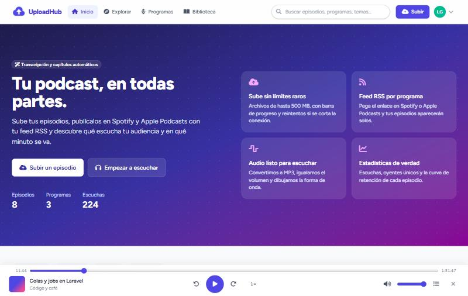
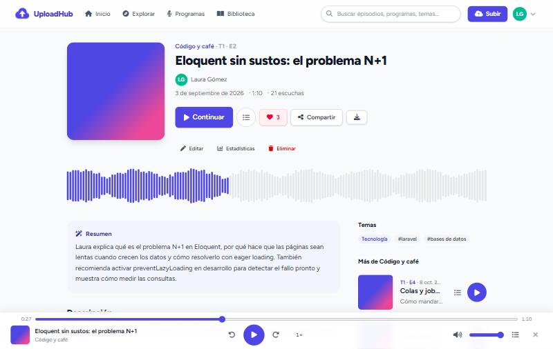
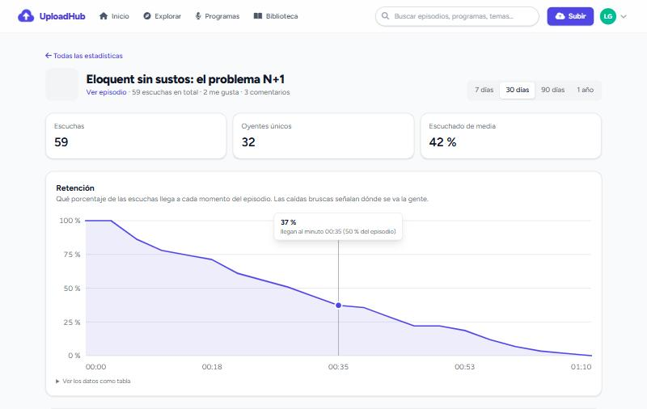

# UploadHub: plataforma de podcasts

Aplicación web para subir, organizar y escuchar podcasts. Cada usuario sube sus episodios (archivo de audio o enlace de YouTube), los clasifica con categorías y etiquetas y decide si son públicos o privados. El resto de la comunidad puede explorarlos, escucharlos, darles "me gusta" y comentarlos.

Es mi proyecto de fin de curso (TFG), desarrollado entre mayo y junio de 2025 con Laravel.



## Funcionalidades

- **Cuentas de usuario:** registro, inicio de sesión, recuperación de contraseña y página de ajustes del perfil.
- **Subida de episodios:** archivos MP3, WAV, M4A, OGG o MP4 (hasta 50 MB) o un enlace de YouTube, con portada, descripción, categoría y etiquetas.
- **Privacidad por episodio:** los episodios privados solo los ve, reproduce y descarga quien los subió.
- **Explorar:** listado público con buscador, filtro por categoría, reproductor propio (play, barra de progreso y volumen), botón de compartir y descarga en MP3.
- **Interacción:** "me gusta" sin recargar la página (petición AJAX) y comentarios en cada episodio.
- **Tu biblioteca:** panel con tus estadísticas, tus episodios y tus favoritos. Las tablas se pueden ordenar por título, fecha, autor, categoría o etiqueta, y tienen buscador y paginación independientes.
- **Edición y borrado:** solo el autor puede editar o eliminar sus episodios. Al borrar un episodio también se elimina su archivo.

| Página de episodio | Estadísticas (curva de retención) |
|---|---|
|  |  |

## Tecnologías

| Capa | Herramientas |
|---|---|
| Backend | PHP 8.2, Laravel 12, Eloquent ORM |
| Frontend | Blade, Tailwind CSS, Alpine.js, SweetAlert2, Vite |
| Autenticación | Laravel Breeze |
| Idioma | Español por defecto (`lang/es`, generado con Laravel Lang) |
| Base de datos | MySQL (en los tests, SQLite en memoria) |
| Tests | Pest |

## Modelo de datos

```
roles ─┐
       └─< users ─┬─< audios >─┬─< audio_category >── categories
                  │            ├─< audio_tag >─────── tags
                  │            └─< comments
                  └─< audio_user_likes >── audios
```

- Un usuario tiene muchos episodios (`audios`) y muchos comentarios.
- Categorías y etiquetas se relacionan con los episodios mediante tablas intermedias (N:M).
- Los "me gusta" son una relación N:M entre usuarios y episodios (`audio_user_likes`).

## Cómo se protegen los audios privados

Los archivos de audio **no** se guardan en la carpeta pública. Van al disco privado de Laravel (`storage/app/private`) y se sirven por la ruta `GET /audios/{audio}/stream`, que antes comprueba si el usuario puede verlo (`Audio::isVisibleTo()`):

- **Episodio público:** cualquiera puede escucharlo, también sin cuenta.
- **Episodio privado:** solo su autor. Para cualquier otra persona la ruta responde 404, así no se revela que el episodio existe.

La misma comprobación protege la descarga, los "me gusta" y los comentarios. La ruta de reproducción usa `response()->file()`, que admite peticiones `Range`; gracias a eso se puede saltar a cualquier punto del audio. Las portadas sí van al disco público.

## Instalación

Requisitos: PHP 8.2 o superior, Composer, Node.js y MySQL.

```bash
git clone https://github.com/alejandrocorral509/ProyectoTGFPodcasts.git
cd ProyectoTGFPodcasts

composer install
npm install && npm run build

cp .env.example .env
php artisan key:generate
```

Crea una base de datos llamada `proyectotgfpodcasts` y pon tus credenciales en las variables `DB_*` del `.env`. Después:

```bash
php artisan migrate --seed   # tablas + roles, categorías y un usuario administrador
php artisan storage:link     # enlace público para las portadas
php artisan serve
```

La aplicación queda en <http://localhost:8000>. Las credenciales del administrador de ejemplo están en `database/seeders/DatabaseSeeder.php`; cámbialas antes de usar la aplicación fuera de tu equipo.

> La aplicación admite audios de hasta 50 MB. Para que PHP los deje pasar, revisa tu `php.ini` y pon `upload_max_filesize` y `post_max_size` en `64M` o más (en XAMPP vienen a 40M).

> Para probarla sin MySQL, pon `DB_CONNECTION=sqlite` en el `.env`, borra la línea `DB_DATABASE` y crea un archivo vacío en `database/database.sqlite`.

## Tests

```bash
php artisan test
```

La suite tiene 34 tests:

- **Autenticación y perfil:** registro, login, logout, recuperación y cambio de contraseña, verificación de correo, edición y borrado de la cuenta.
- **Episodios** (`tests/Feature/AudioTest.php`):
  - los archivos se guardan en el disco privado;
  - los episodios privados no se pueden reproducir, descargar, comentar ni marcar con "me gusta" desde otra cuenta;
  - nadie puede borrar episodios de otro usuario;
  - un visitante sin cuenta ve los episodios públicos y no los privados;
  - el seeder crea las categorías necesarias para subir episodios.

## Estructura principal

```
app/
  Http/Controllers/
    AudioController.php      # subir, editar, borrar, listar, reproducir, descargar, me gusta
    CommentController.php
    ProfileController.php
    Auth/                    # login, registro y contraseñas (Breeze, adaptado)
  Models/                    # Audio, User, Category, Tag, Comment, Role
database/
  migrations/
  seeders/                   # roles, categorías y administrador
resources/views/
  audios/                    # explorar, subir, editar
  dashboard.blade.php        # "Tu biblioteca"
routes/web.php
tests/Feature/
```

## Pendiente

- Permitir descargar en otros formatos además de MP3.
- Usar el rol de administrador para moderar comentarios y episodios.

## Autor

**Alejandro Corral Carrasco**: [GitHub](https://github.com/alejandrocorral509)
