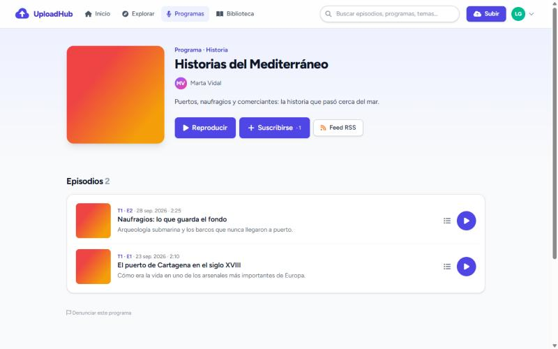

# UploadHub: plataforma de podcasts

Aplicación web para publicar, escuchar y medir podcasts. Quien crea sube sus episodios, los agrupa en programas con feed RSS para Spotify y Apple Podcasts, y ve cuánta gente los escucha y en qué minuto se va. Quien escucha explora, se suscribe a programas y tiene un reproductor que no se corta al navegar y que recuerda dónde lo dejó.

Nació como mi proyecto de fin de curso (TFG, mayo-junio de 2025). En octubre de 2026 lo rehíce casi por completo: corregí sus fallos de seguridad y añadí las funciones que lo convierten en una plataforma completa.


| Página de episodio | Estadísticas: curva de retención |
|---|---|
|  |  |



## Funcionalidades

### Para quien escucha
- **Reproductor persistente.** Sigue sonando al cambiar de página (navegación con Turbo). Incluye cola de reproducción, velocidad de 0,75× a 2×, saltos de −15 y +30 s y controles en la pantalla de bloqueo del móvil (Media Session API).
- **Continuar donde lo dejaste.** El progreso se guarda en el servidor, así que se puede seguir desde otro dispositivo.
- **Explorar.** Búsqueda por título, descripción, etiquetas, autor, programa o lo que se dice dentro del episodio, si está transcrito. Filtros por categoría y orden por recientes, me gusta o escuchas.
- **Programas y suscripciones.** Los episodios nuevos de los programas a los que te suscribes aparecen en tu biblioteca.
- **Página propia por episodio**, con forma de onda en la que se puede pulsar para saltar, capítulos, comentarios, me gusta, compartir y descarga.
- **Perfiles públicos** de cada creador.

### Para quien publica
- **Subida por trozos** de hasta 500 MB, con barra de progreso real y reintentos automáticos si se corta la conexión. El archivo se sube mientras rellenas el formulario.
- **Procesado automático con ffmpeg:** duración, conversión a MP3 con el volumen normalizado al estándar de podcasts (−16 LUFS) y forma de onda.
- **Programas con feed RSS** compatible con Apple Podcasts y Spotify: temporadas, números de episodio, portada, categoría y contenido explícito.
- **Episodios públicos o privados.** Un episodio privado solo lo ve y lo escucha su autor; para cualquier otra persona, la dirección responde 404, como si no existiera.
- **Episodios de YouTube.** Vale cualquier formato de enlace: normal, corto, de móvil o de Shorts.
- **Estadísticas:**
  - escuchas, oyentes únicos y qué parte de cada episodio se escucha de media;
  - me gusta, suscriptores y comentarios nuevos;
  - gráfica de escuchas por día;
  - **curva de retención** de cada episodio, que muestra qué porcentaje llega a cada minuto.

### Moderación
- **Denuncias** de episodios, programas y comentarios.
- **Panel de administración:** resolver denuncias, bloquear usuarios (se les cierra la sesión al momento) y moderar episodios y comentarios.

### API REST
Una API versionada (`/api/v1`) con autenticación por token (Laravel Sanctum), pensada para una app móvil. La tabla de rutas está [más abajo](#api).

## Tecnologías

| Capa | Herramientas |
|---|---|
| Backend | PHP 8.2, Laravel 12, Eloquent, colas (jobs en base de datos), Sanctum |
| Frontend | Blade, Tailwind CSS 4, Alpine.js, Turbo, Vite. Sin dependencias de CDNs: todo va empaquetado |
| Audio | ffmpeg y ffprobe (opcionales) |
| Archivos | Disco local o S3 / Cloudflare R2 |
| Base de datos | MySQL; SQLite en desarrollo y en los tests |
| Calidad | Pest (138 tests, con SQLite y MySQL), Laravel Pint y GitHub Actions |

## Cómo está hecho

- **Los audios nunca son públicos en el disco.** Se guardan en el disco privado y se sirven por `GET /episodios/{id}/stream`, que comprueba los permisos antes de entregar el archivo:
  - admite peticiones `Range`, así que se puede saltar a cualquier punto;
  - el tipo de archivo se detecta del contenido, nunca de lo que dice el navegador, y se envía con `X-Content-Type-Options: nosniff`;
  - en S3 o R2 responde con una URL firmada de corta duración.
- **El trabajo pesado va en segundo plano.** Al subir un episodio se publica al momento y el job `ProcessAudio` lo procesa en la cola. Si ffmpeg no está instalado, el episodio se publica igualmente, sin procesar.
- **El reproductor vive en un elemento permanente.** Es un store de Alpine dentro de un elemento con `data-turbo-permanent`: Turbo cambia el resto de la página y el `<audio>` sigue sonando.
- **Escuchas sin datos personales.** Cada escucha se identifica con un hash del usuario o de la sesión. Volver a darle al play antes de 30 minutos no cuenta como escucha nueva. Cada 15 segundos el reproductor envía hasta dónde ha llegado, y de ahí sale la curva de retención.
- **Sin consultas N+1.** Fuera de producción, cargar una relación sin *eager loading* lanza un error (`Model::preventLazyLoading`). Un test recorre todas las páginas con datos de demo, así que cualquier N+1 nuevo rompe los tests.
- **Permisos en políticas** (`AudioPolicy`, `ShowPolicy`, `CommentPolicy`) **y validación en FormRequests.** Los administradores pueden borrar cualquier contenido mediante `Gate::before`.
- **Seguridad:**
  - límite de 5 intentos de login por correo e IP;
  - límites de peticiones en registro, comentarios, me gusta, denuncias y subidas;
  - sesión regenerada al entrar;
  - contraseñas con letras y números;
  - ningún administrador con credenciales conocidas;
  - contraseñas, correos y roles ocultos en las respuestas JSON.

### Modelo de datos

```
users ─┬─< shows ──────< audios (episodios) >──┬─< comments
       │     │                │                ├─< plays (escuchas)
       │     └─< subscriptions│                ├─< audio_category >── categories
       │                      │                └─< audio_tag >─────── tags
       ├─< audio_user_likes >─┘
       ├─< playback_progress (dónde se quedó cada usuario)
       └─< reports (denuncias de episodios, programas o comentarios)
```

## Instalación

Requisitos: PHP 8.2 o superior (con `pdo_sqlite` o `pdo_mysql` y `fileinfo`), Composer y Node.js 20. ffmpeg es opcional.

```bash
git clone https://github.com/alejandrocorral509/uploadhub.git
cd uploadhub
composer install
npm install && npm run build
cp .env.example .env
php artisan key:generate
```

### Base de datos
Para probar rápido con **SQLite**, pon en el `.env` `DB_CONNECTION=sqlite`, borra la línea `DB_DATABASE` y crea el archivo vacío:

```bash
touch database/database.sqlite
```

Con **MySQL**, crea la base de datos `proyectotgfpodcasts` y rellena las variables `DB_*`.

Después:

```bash
php artisan migrate --seed            # tablas, roles y categorías
php artisan db:seed --class=DemoSeeder  # opcional: usuarios, programas, episodios y escuchas de ejemplo
php artisan storage:link              # enlace público para las portadas
composer run dev                      # servidor + cola de trabajos + Vite
```

La aplicación queda en <http://localhost:8000>.

- **Datos de demostración:** crea 4 usuarios (`laura@demo.test`, `dani@demo.test`, `marta@demo.test` y `pablo@demo.test`) con 3 programas, 8 episodios con audio, comentarios y un mes de escuchas para que las estadísticas tengan datos. La contraseña es la de `DEMO_PASSWORD` en el `.env` o, si no la defines, `demo-uploadhub`. Son datos solo para desarrollo.
- **Administrador:** rellena `ADMIN_EMAIL` y `ADMIN_PASSWORD` antes de `db:seed`, o da el rol a un usuario que ya exista:

  ```bash
  php artisan user:make-admin correo@ejemplo.com
  ```

- **ffmpeg:** si está instalado y en el `PATH`, los episodios se procesan solos. Si no, se publican tal cual. Las rutas se configuran con `FFMPEG_BINARY` y `FFPROBE_BINARY`.
- **Cola de trabajos:** `composer run dev` ya arranca el worker. En producción hace falta `php artisan queue:work` y el programador de tareas (`php artisan schedule:run` cada minuto), que borra a diario las subidas abandonadas.

## Tests

```bash
php artisan test
```

138 tests con Pest:

| Archivo | Qué cubre |
|---|---|
| `EpisodeTest` | Subida, validación, archivos que no son audio, enlaces de YouTube, edición, borrado de archivos, privacidad (404 en todas las rutas), `Range`, descarga, me gusta y comentarios |
| `ChunkedUploadTest` | Subida por trozos, reintentos, subidas ajenas, contenido real frente a extensión y limpieza de subidas abandonadas |
| `ShowTest` | Programas, slugs, suscripciones y feed RSS (XML válido, solo episodios públicos con archivo) |
| `PlayTest` y `StatsTest` | Recuento de escuchas, progreso, finalización, oyentes únicos y curva de retención |
| `AdminTest` y `SecurityTest` | Panel, denuncias, bloqueo de cuentas, límites de peticiones, sesión y datos ocultos en JSON |
| `ApiTest` | Tokens, listados, privacidad con token, me gusta, comentarios y suscripciones |
| `ProcessingTest` | Procesado real con ffmpeg (se salta si no está instalado) y publicación sin ffmpeg |
| `PagesTest` | Todas las páginas con los datos de demo; detecta N+1 |
| `DemoTest` | Modo demo: entrada sin registro, cuentas protegidas, límites diarios y reinicio |

En cada push, **GitHub Actions** comprueba el estilo con Pint, audita las dependencias con `composer audit` y `npm audit`, compila el frontend y pasa los tests dos veces: con SQLite y con **MySQL 8.4**, la versión de producción. También ejecuta las migraciones de ida y vuelta en MySQL e instala ffmpeg con el mismo script que el despliegue.

## API

Base: `/api/v1`. Para usar las rutas protegidas, pide un token y envíalo en la cabecera `Authorization: Bearer <token>`. Las rutas públicas también aceptan el token: con él, el autor ve sus propios episodios privados.

| Método | Ruta | Acceso | Descripción |
|---|---|---|---|
| POST | `/tokens` | Público | Cambia `email`, `password` y `device_name` por un token |
| DELETE | `/tokens/current` | Token | Cierra la sesión del token actual |
| GET | `/me` | Token | Datos del usuario |
| GET | `/me/feed` | Token | Últimos episodios de los programas suscritos |
| GET | `/episodes` | Público | Episodios públicos. Parámetros: `q`, `category`, `sort=popular`, `per_page` |
| GET | `/episodes/{id}` | Público | Detalle; con `?transcripcion=1` incluye la transcripción |
| GET | `/episodes/{id}/comments` | Público | Comentarios |
| POST | `/episodes/{id}/comments` | Token | Comentar |
| POST | `/episodes/{id}/like` | Token | Dar o quitar me gusta |
| GET | `/shows` | Público | Programas con episodios públicos |
| GET | `/shows/{slug}` | Público | Detalle del programa, con su `feed_url` |
| GET | `/shows/{slug}/episodes` | Público | Episodios del programa |
| POST | `/shows/{slug}/subscription` | Token | Suscribirse o darse de baja |

Las respuestas siguen el formato de los API Resources de Laravel (`data`, más `links` y `meta` en los listados) y nunca incluyen el correo de otros usuarios.

## Despliegue

La demo pública está pensada para **[Laravel Cloud](https://cloud.laravel.com)**: web y base de datos MySQL que se duermen sin visitas, buckets de Cloudflare R2 para los audios y las portadas, y una cola gestionada para el procesado. La guía paso a paso está en **[docs/DESPLIEGUE.md](docs/DESPLIEGUE.md)**.

Para cualquier otro servidor:

- **Archivos:** con `MEDIA_DISK=s3` y las variables `AWS_*`, los audios van a S3 o Cloudflare R2.
- **Correo:** configura `MAIL_*` con un servidor SMTP real para que funcione la recuperación de contraseña.
- **Procesos:** un worker de la cola (`php artisan queue:work`), el programador de tareas y ffmpeg (el script `deploy/ffmpeg.sh` lo descarga si no se puede instalar).
- **Tamaño de subida:** las subidas van por trozos de 5 MB, así que basta con que PHP admita algo más de 5 MB por petición.

### Modo demo

Con `DEMO_MODE=true`, la aplicación se comporta como demo pública:

- un botón permite **entrar con una cuenta de ejemplo** sin registrarse;
- las cuentas de ejemplo no se pueden modificar ni borrar;
- cada cuenta puede crear 3 episodios y 1 programa al día, con archivos de hasta 25 MB;
- **cada noche** `demo:reset` borra todo y vuelve a cargar los datos de ejemplo.

Nunca se debe activar en una instalación con datos reales.

## Hoja de ruta

- **Transcripción y resúmenes con IA (en preparación).** Cada episodio público se transcribirá con Whisper y, a partir del texto, Claude generará un resumen y capítulos con marca de tiempo. La transcripción también servirá para buscar episodios por lo que se dice en ellos. El código y sus tests ya están hechos (`App\Jobs\TranscribeAudio`, `config/ai.php`), pero está desactivado (`AI_*_DRIVER=none`) hasta conectar las cuentas de las APIs. Por privacidad, solo se enviarán episodios públicos. La demo incluye un episodio con resumen y capítulos de ejemplo para ver cómo quedará.
- **Demo pública desplegada** en Laravel Cloud.
- **App Android** que use la API.

## Estructura

```
app/
  Http/Controllers/        Episodios, programas, biblioteca, estadísticas, subidas, escuchas…
    Admin/                 Panel de administración
    Api/V1/                API REST
  Http/Requests/           Validación (EpisodeRequest, ShowRequest…)
  Http/Resources/          Formato JSON de la API
  Jobs/                    ProcessAudio (ffmpeg) y TranscribeAudio (IA)
  Models/                  Audio (episodio), Show, User, Play, PlaybackProgress, Report…
  Policies/                Permisos
  Services/                ChunkedUpload, AudioProcessor, Ai/
config/media.php           Discos, tamaños y ffmpeg
config/ai.php              Transcripción y resumen (desactivados por defecto)
database/seeders/          Roles, categorías, administrador y DemoSeeder (con audios en demo/)
resources/js/              Reproductor, subida por trozos y componentes de Alpine
resources/views/           Vistas Blade y componentes (tarjetas, gráficas SVG…)
tests/                     Pest: Feature y Unit
```

## Cómo se ha hecho

El TFG original (2025) lo programé yo, con Laravel, Blade y Tailwind. La reconstrucción de 2026 la he hecho trabajando con un **agente de IA (Claude Code)**:

- **Mi parte:** decidir qué construir y en qué orden, revisar cada cambio, probar la aplicación y aceptar o corregir las propuestas.
- **La del agente:** buena parte del código y de los tests.

Para entender y poder explicar cada pieza he escrito una **[guía del código](docs/GUIA-DEL-CODIGO.md)**. Recorre la aplicación capítulo a capítulo, con ejercicios y preguntas de entrevista.

## Autor

**Alejandro Corral Carrasco**: [GitHub](https://github.com/alejandrocorral509)
